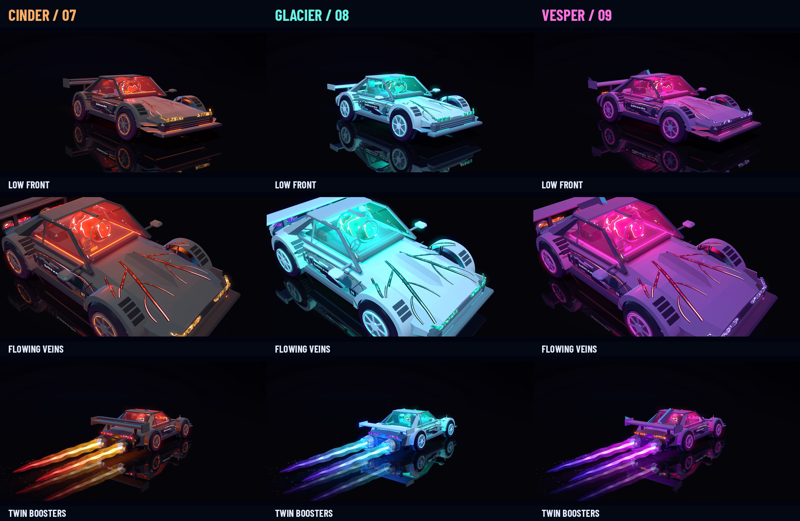

# Afterlight work — Three-car Vein Series

This branch preserves the selected **Cinder, Glacier and Vesper** motion-graphics version. The magenta Vesper is the original futuristic car with its exposed glowing cabin, dorsal fin, flowing lava veins and powerful twin boosters.

[Watch / download the original 30-second film](afterlight/AFTERLIGHT_30s.mp4) · [Download the original source ZIP](afterlight/AFTERLIGHT_Source.zip) · [Project instructions](afterlight/README.md)

The film is 1920×1080, 30 fps, with stereo sound. Cinder appears at 0–9 seconds, Glacier at 9–18 seconds, Vesper at 18–27 seconds, and all three together at 27–30 seconds.

The `afterlight/` folder contains the original source code and GLSL shaders, all three editable GLB models, the original soundtrack, previews, movie and downloadable source archive. See [SNAPSHOT.json](afterlight/SNAPSHOT.json) for the selected files and their checksums. The source files were extracted unchanged from the original three-car source ZIP.

To reproduce the film, follow [afterlight/README.md](afterlight/README.md). The renderer uses free Python, EGL/OpenGL and FFmpeg tools.
