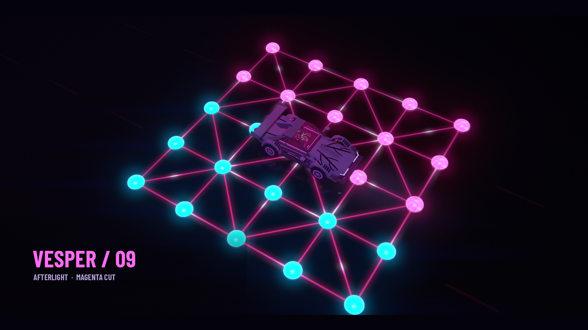
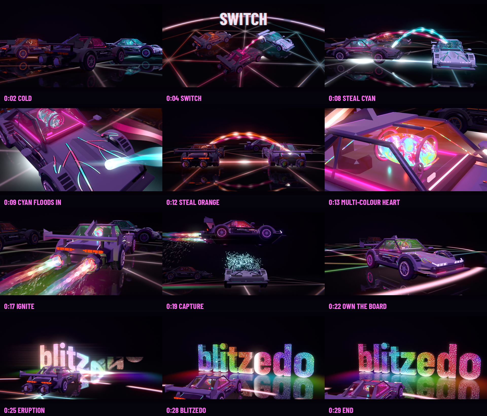
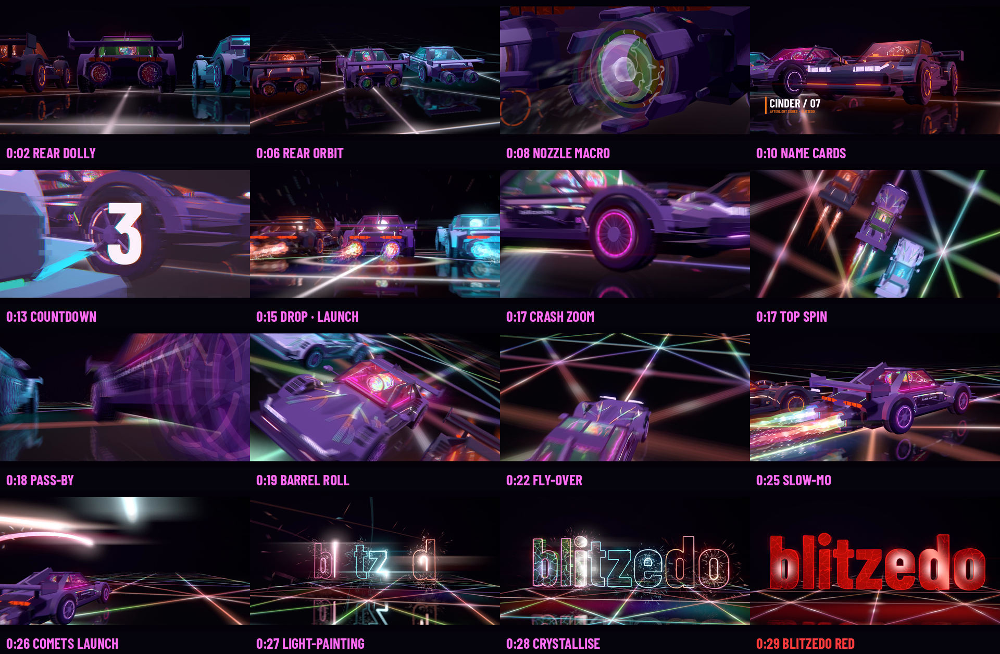

# Magenta work: Vesper refined, and a game to put it in

Branch `ccr-58f4b888-im2lf6`, built on top of [`after-light-work`](AFTERLIGHT_WORK.md). It holds five
pieces, in reading order:

1. **[Learned concepts](docs/afterlight-study/LEARNED-CONCEPTS.md).** What makes the magenta Vesper
   work (colour, tinted shadow, energy that lights the paint, vein pulses, shader plumes), what held it
   back, and 13 refinements, with what carries over to a phone game.
2. **[VESPER / 09 — MAGENTA CUT](vesper/README.md).** A new 30-second film where the energy has a
   route: heartbeat → lava flood → lamps → sputter and ignition → run → chase → cool-down on a
   Barah Goti board. **[Watch it](vesper/VESPER_30s.mp4).**
3. **[HIJACK TWELVE](hijack12/HIJACK-TWELVE.md).** The game concept. Barah Goti (12 beads) with a
   build-wreck **Switch**: every 12 turns each player moves one *rival* bead, and Barah Goti's
   mandatory captures turn that into traps. It is backed by bot experiments on the real BarahAI engine.

4. **[THE HIJACK](hijack_film/README.md).** The story film with a blitzedo reveal, made after owner feedback
   ("sounds need work, some actual story, blitzedo reveal, insane mix of colors"). Vesper starts cold, steals
   cyan and orange from its rivals, captures Glacier with a slow-motion boost-jump, floods the board, and the
   3D lava **blitzedo** letters erupt. It has a new trailer-style score. **[Watch it](hijack_film/HIJACK_30s.mp4).**

5. **[BLITZ CUT](blitz_cut/README.md).** A beat-synced 128 BPM edit. It opens on slow cinematic shots behind
   the cars and boosters, then a build with a 3-2-1 countdown, and a fast drop on an endless Barah Goti highway
   (launch, whip pans, crash zoom, top-down spin, pass-by, barrel roll, overtake, fly-over, glitch montage),
   a slow-motion ramp, and a light-painted blitzedo. The cars' comets write it, it crystallises into lava-filled
   glass, and it resolves into brand red. **[Watch it](blitz_cut/BLITZ_30s.mp4).**

All of it is a proposal for owner review. The Afterlight originals in `afterlight/` are unchanged.
