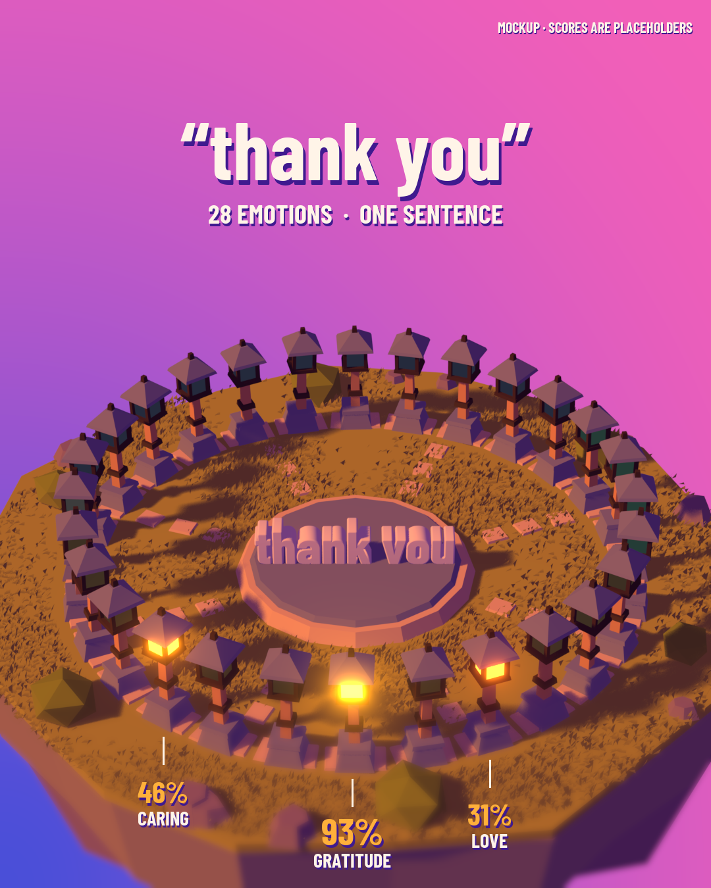
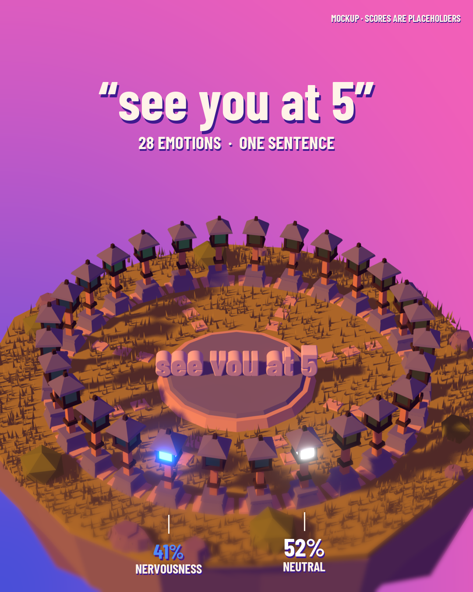

# Emotion Lanterns

A 20-second motion piece for [emotion-detection-in-text](https://github.com/SilverUmer21/emotion-detection-in-text),
a DeBERTa-v3 model that tags text with 28 emotions at once (GoEmotions, macro F1 0.49).

Each of the 28 emotions is a lantern on a small floating island. A sentence slams down onto the
dais, and the lanterns light up as strongly as the model scores each emotion.

**[Watch the video](renders/emotion-lanterns.mp4)** (MP4, 20 s, 1080 × 1350)

| "thank you" | "see you at 5" |
|---|---|
|  |  |

> **Placeholder scores.** The lantern percentages in this cut are made up to block out the
> animation. The fact card is real: on the GoEmotions test set, nervousness precision is 0.10
> (about 9 in 10 "nervous" calls are wrong) and recall is 0.70. A future cut will use scores from
> the trained checkpoint.

## How it's made

Everything is generated by script in Blender 5.2 (EEVEE) and Python. There are no hand-placed
keyframes.

| Script | What it does |
|---|---|
| `lanterns_scene.py` | Shared models, materials and grade. Run on its own, it renders one still |
| `lanterns_video.py` | Sets every frame procedurally: letter slam, dust, shockwave, camera kick, lantern glow, island spin, pull-back |
| `compose_video.py` | Text pass: captions, score labels, fact card, end card |
| `compose_frame.py` | Text pass for the stills |
| `encode.py` | Encodes the H.264 MP4 with Blender's built-in FFmpeg |

```bash
blender -b --factory-startup --python lanterns_video.py -- --frames 0-599
python compose_video.py
blender -b --factory-startup --python encode.py
```

A frame takes about 5 s on an RTX 3050 Ti laptop GPU. The text pass needs Pillow, and the Blender
scripts use Blender's bundled NumPy.

[STYLE.md](STYLE.md) has the model rules, palette, shading model and the beat sheet.
[docs/folio-study/](docs/folio-study/FOLIO-2025-STUDY.md) is the full study of folio-2025's art,
lighting and mechanics that the look is built on. Its figures are re-rendered from the extracted
maths by `folio_style_figures.py`.

## Credits

- The model and project are by Muhammad Umer, Muhammad Ahmed Bajwa and Muhammad Shayan Qadir
  (FAST University, Lahore).
- The look is inspired by Bruno Simon's [folio-2025](https://github.com/brunosimon/folio-2025)
  (MIT). The techniques are reimplemented here; no code or models are copied.
- The font is [Barlow Condensed](https://github.com/jpt/barlow) under the SIL Open Font License
  (`fonts/OFL.txt`).
