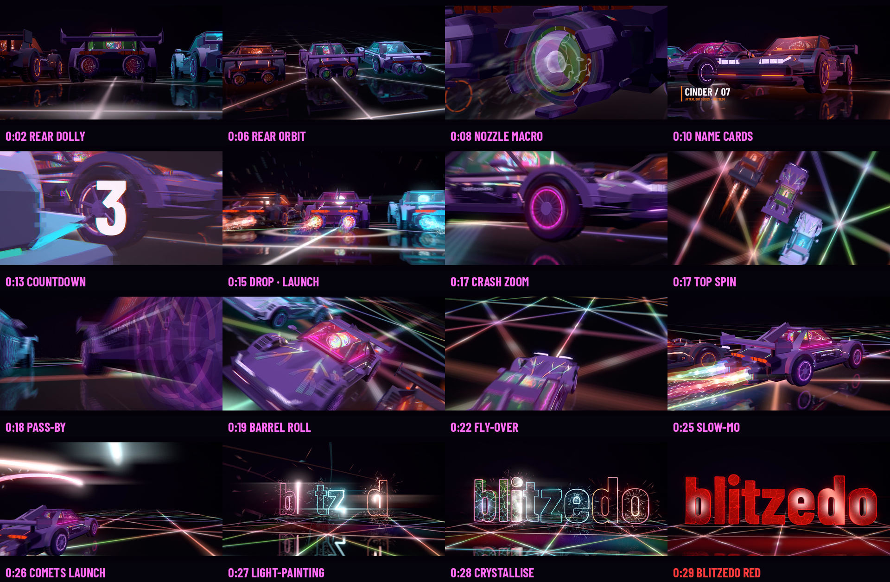

# BLITZ CUT — a beat-synced blitzedo edit

30 seconds · 1920×1080 · 30 fps · stereo · 128 BPM, every cut on the grid.

**[Watch BLITZ_30s.mp4](BLITZ_30s.mp4)**



Owner brief: slow cinematic shots first, from behind the cars and the boosters; then really fast
camera angles, shots, transitions and animations, all synced to the beat.

## The edit (bar = 1.875 s)

| Bars | Time | Shots | Music |
|---|---|---|---|
| 1–2 | 0–3.75 s | **Rear dolly:** almost on the floor, creeping up between Vesper's twin nozzles, pilot flames flickering | Dark Fm9 pad opening, half-time heartbeat kick, sub |
| 3–4 | 3.75–7.5 s | **Rear orbit:** a slow arc behind the three-car grid; the nozzle petals open on beat 3 of bar 4 | High arpeggio enters, reverse swells, petal ticks on 16ths |
| 5 | 7.5–9.4 s | **Nozzle macro:** the core ring pulses on every beat | Backbeat, hats, sidechained bass, a tone on each core pulse |
| 6 | 9.4–11.25 s | **Name cards:** GLACIER, CINDER, VESPER, one per beat as each car's lamps fire, then all three noses | A lamp clunk, taiko and whoosh per card |
| 7 | 11.25–13.1 s | **Build:** a cut on every beat (heart, Cinder's rear, Glacier's nose, Vesper's face) with whip-ins | Kick on every beat, eighth snares, riser |
| 8 | 13.1–15 s | **Strobe:** half-beat cuts with a glitch, a giant **3 · 2 · 1**, then a black, silent beat | The roll speeds up to 32nds, countdown braams, dead silence |
| 9 | 15–16.9 s | **Launch:** a camera fixed to the floor as the pack ignites and blasts away, then a whip pan to side tracking | THE DROP: braam, sub drop, four-on-the-floor, reese bass, chord stabs, roar |
| 10 | 16.9–18.75 s | **One shot per beat:** crash zoom onto a wheel, a top-down spin, a low front chase, a floor-camera pass-by | Whooshes on every whip; a doppler pass-by |
| 11 | 18.75–20.6 s | **Barrel roll:** a full orbit with camera roll, a nozzle smear at speed, the multi-colour heart | Braam on the downbeat |
| 12 | 20.6–22.5 s | **Overtake:** Vesper surges past Cinder; a drone dives over the pack | |
| 13 | 22.5–24.4 s | **Glitch montage:** eight half-beat cuts with alternating whips and slice glitches | Stutter repeats on the last two beats |
| 14 | 24.4–26.25 s | **Slow motion:** time ramps to 20%, a slow arc around Vesper as the race brakes | Tape stop, drone, slow heartbeats, reverse swell |
| 15 | 26.25–28.1 s | **Light-painted blitzedo:** each car fires a comet (magenta, cyan, orange) out of its nozzles. The comets loop over the pack and write the word in the air along the real letter outlines, on beats 2–4, shedding sparks | Comet zips, a sizzling laser-pen voice per comet panning as it writes, a bell as each letter closes (F Yaman) |
| 16 | 28.1–30 s | **Crystallise:** on the downbeat the strokes grow into thick glass letters, left to right. Two layers of prism lava flow inside at different depths, hearts glow in the bowls of b, e, d and o, chrome-prism bevels, and the strokes stay on as neon outlines with pulses. Then a light sweep, and a heartbeat wave runs through every letter | Reverse swell, glass impact, braam chord, a cascade of crystal pings, sweep shimmer, final heartbeat and chord bloom |

## How it's built

- **`cut.py`** reuses the story film's renderer ([`hijack_film/film.py`](../hijack_film/README.md))
  and the unchanged Afterlight cars, and swaps in this edit's timeline, cameras and post-processing.
  - **The beat grid** (`bar()`, `KICKS`) drives every shot boundary, whip-in, flash, glitch window,
    lattice pulse, bloom pump and camera punch.
  - **Two clocks:** wall time drives the edit and the overlays; story time (`tau`) drives the cars,
    so the slow-motion bar can slow the world without slowing the cuts.
  - **The highway:** the cars stay put while the floor travels. The Barah Goti lattice repeats
    endlessly and is motion-blurred analytically. "Ground" cameras (launch, pass-by) subtract the
    travel, so the pack really tears past them.
  - **Transitions:** whip-ins (the view swings in over 0.12 s with up to 9 motion-blur sub-frames),
    two-frame cut flashes, zoom blur on crash zooms, the drop and the slam, slice glitch and
    chromatic split on the strobe and montage.
  - **Motion graphics:** per-beat name cards and the 3-2-1 countdown are drawn as overlays.
- **`logo_vec.py`** builds the reveal from the font's real vector outlines (fontTools):
  - glass letters triangulated with their counters (earcut), with a bevel ring, sides and back
  - the three comet paths, where every vertex knows when the head reaches it
  - 2,400 sparks, each with its own emission time

  The shaders are `glasslogo.frag` (parallax lava veins, bowl hearts, a crystallising fill front,
  the sweep and the heartbeat wave), `stroke.*` (the light-painting) and `lspark.*`.
- **`score.py`** builds the track on the same grid with **`synth.py`** (the story film's NumPy and
  SciPy instruments). Part A (to bar 14) is mixed, then stuttered, gated and tape-stopped. Part B (the
  slow-motion bar and the logo) is mixed separately and summed. `master.py` masters to −14 LUFS /
  −1 dBTP.

## Reproduce

```bash
cd blitz_cut
python3 cut.py --stills --width 1920 --height 1080       # stills -> renders/
python3 cut.py --width 2560 --height 1440 --subframes 3  # picture (~50-100 min on 4 CPU threads)
# the logo section can be re-rendered on its own and spliced in:
#   python3 cut.py --width 2560 --height 1440 --start 26.2667 --seconds 3.7333 --output BLITZ_logo.mp4
python3 score.py && python3 master.py                    # -> BLITZ_30s.mp4
# needs: pip install fonttools mapbox_earcut scipy
```
