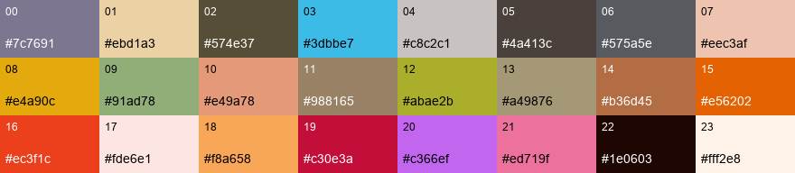
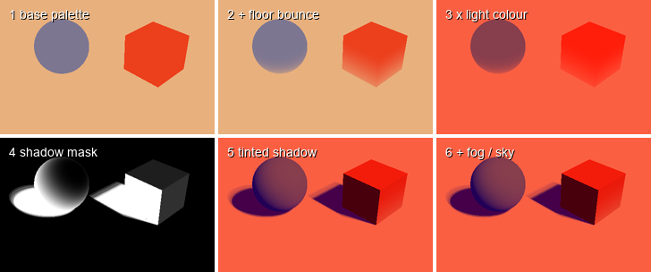
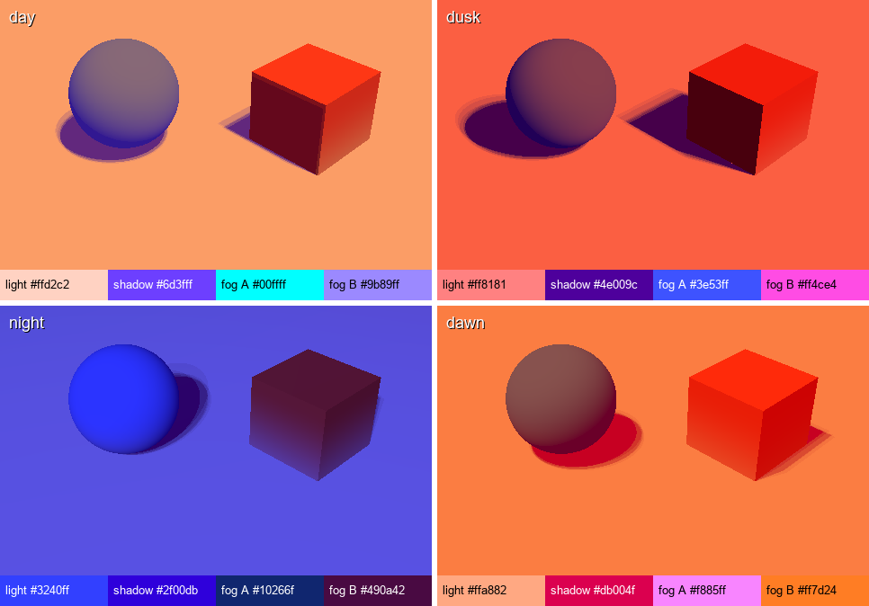

# Style study — Bruno Simon's folio 2025

Version 1 · 2026-10-31 · Owner request: deep analysis of the art style, mechanics and lighting of
[bruno-simon.com](https://bruno-simon.com) and its source, as a house style for future games and
LinkedIn motion posts. **This is research, not an approved art direction.** Scrap Rivals keeps
its approved "sunny toy scrapyard" direction until the owner decides otherwise.

**How to read this.** *Observed* = read in the source code, measured in an image or stated by the
author. *Inference* = our interpretation. Code facts refer to
[brunosimon/folio-2025](https://github.com/brunosimon/folio-2025) at commit `41046b5`
(2026-04-07), MIT licence. Figures in this folder are our own renders of the extracted maths
([folio_style_figures.py](folio_style_figures.py)), not screenshots.

## 0. The style in twelve rules

1. **One sun, no lamps.** A single directional light does all the lighting. Lanterns and headlights
   don't light anything: they are emissive materials that bloom. *(observed)*
2. **Shadows are a colour, not darkness.** Shadowed pixels become `base × shadowColor`, a saturated
   violet or magenta, never grey. *(observed)*
3. **Form shadow and cast shadow are merged** into one tint with `max()`, so there's only one
   shadow colour on screen. *(observed)*
4. **The light wraps.** Shading starts at N·L = 1 and is full only at N·L = −0.25, so most faces
   carry a soft gradient. *(observed)*
5. **One 24-colour palette texture** colours every model through its UVs. No other textures on
   props. *(observed)*
6. **The ground colours what touches it.** Downward faces near the floor mix toward the terrain
   colour beneath them. It's cheap fake bounce light. *(observed)*
7. **Sky = fog.** A diagonal two-colour screen gradient is both the background and the fog colour.
   *(observed)*
8. **Time of day is four colour presets** (light, shadow, fog A, fog B), blended on a shared
   four-minute clock. *(observed)*
9. **Chunky toy hard-surface.** Bevelled low poly, big wheels, no outlines; chamfers catch the
   light. *(observed in renders; "toy" is inference)*
10. **A living carpet.** Tens of thousands of single-triangle grass blades, dark at the root and lit
    at the tip, plus wind on everything. *(observed)*
11. **Telephoto diorama camera.** 25° FOV at a fixed 45° diagonal. It pulls back with speed and
    rolls on impacts. *(observed)*
12. **Everything is a toy you can knock over**, and every hit makes a sound. *(observed)*

## 1. Sources

| Source | What it gave us |
|---|---|
| [folio-2025 repository](https://github.com/brunosimon/folio-2025) (sparse clone of `sources/`, small `static/` assets, `resources/renders`) | Shaders (TSL), lighting, cycles, camera, vehicle, world systems, palette, data textures, model renders |
| [Bruno Simon's Awwwards case study](https://www.awwwards.com/brunos-portfolio-case-study.html) | Author's own account of the palette technique, grass, foliage, weather, Blender naming conventions, performance, audio and timeline |
| Owner's three screenshots (the repo's `static/social/share-image.png` and two crops) | Colour measurements at dusk |
| [Hacker News launch thread](https://news.ycombinator.com/item?id=46206531) (2025-12-09, 777 points, 188 comments) | Player and developer criticism of the site |
| Steam negative reviews: [art of rally](https://steamcommunity.com/app/550320/negativereviews/?browsefilter=toprated&filterLanguage=english), [Lonely Mountains: Downhill](https://steamcommunity.com/app/711540/negativereviews/?browsefilter=toprated&filterLanguage=english) | Camera and readability failures of comparable stylized games |
| [Alto's Odyssey on Google Play](https://play.google.com/store/apps/details?id=com.noodlecake.altosodyssey) | Mobile day/night-cycle readability complaints |

The review data is logged in the build-wreck-concept game project (private).

## 2. Art style

### 2.1 Shape language

The vehicle renders in `resources/renders/` show the process: a white clay block-out, then palette
colours, then emissive strips.

- **Proportions:** wheels are about 40% of the vehicle height, with a short wheelbase and a tall,
  boxy cabin. The chassis collider is 2.6 × 0.8 × 1.7 m with 0.4 m wheels. *(observed)* The result
  reads as a toy or RC car, not a real truck. *(inference)*
- **Bevels everywhere:** every edge is chamfered. With the wrapped light, each chamfer becomes a
  thin bright or tinted line, so the model reads without outlines or textures. *(inference from
  renders and shader)*
- **Two-value materials:** one saturated body colour against a near-black warm brown for chassis,
  bumpers and tyres. Rims repeat the body colour. *(observed)*
- **Emissives as punctuation:** headlights, roof lights and tail lights are flat glowing strips.
  They are the brightest pixels in any frame. *(observed)*
- **World props** follow the same rules: chunky wooden benches, bridges and fences, faceted rocks
  and lanterns with lattice panels. *(observed in screenshots)*

### 2.2 The palette texture



`static/palette.png` is a 128 × 4 px strip: 24 swatches, each 4 px wide, sampled with nearest
filtering. Every model's material is named `palette`, and its UVs pick a swatch. The author
explains that this lets merged geometry carry many colours without vertex colours.
*(observed: file, loader settings and case study)* The palette mixes warm earth tones (sand, tan,
rust, olive), a few saturated accents (orange, red-orange, crimson, violet, pink, sky blue) and two
near-blacks/whites.

Additional colours come from code, not the palette *(observed)*:

| Use | Colours |
|---|---|
| Vehicle paints (vertical gradient by UV.y) | red `#ff3a3a → #721551`, orange `#ff940d → #af0071`, white `#ffffff → #b5b5b5`, black `#626262 → #262526` |
| Emissive radial gradients (normalised by luminance, × intensity) | orange `#ff8641 → #ff3e00` ×1.7, purple `#454bbc → #ff2eb4` ×1.7, blue `#91f0ff → #128fff` ×1.7, green `#f8ffa6 → #74ff00` ×1.5, white ×2.7 |
| Terrain depth gradient | sand `#ffa94e` (dry) → teal `#5bc2b9` → navy `#13375f` (deep) |
| Grass | `#b8b62e`; bushes `#b4b536`/`#d8cf3b` |
| Floor slabs | `#a87762` → `#ffcf8b` |
| Road | `#383039` |

**Trick worth stealing:** emissive colours are divided by their own luminance before being
multiplied by intensity. Every glow therefore has the same perceived brightness whatever its hue,
so a blue light and an orange light bloom equally. *(observed; the intent is inference)*

### 2.3 Measured from the owner's screenshot (dusk)

Box-averaged sRGB values from the dusk share image. They are approximate because the boxes are
hand-placed.

| Region | Colour | Hue | Note |
|---|---|---|---|
| Path, lit | `#f08878` | 7° | Warm coral, very saturated (0.80) |
| Car shadow on path | `#61122c` | 340° | Shadow keeps saturation (0.69) and shifts toward magenta |
| Rock (lit and shadow) | `#602964` / `#5c2961` | 295° | Lavender palette grey becomes violet |
| Water | `#41275d` | 268° | Deep indigo |
| Car lower body | `#b83549` | 350° | Gradient paint × pink dusk light |
| Headlight core | `#fada73` | 45° | Warmest, brightest pixel |
| Distant background | `#99557e` | 323° | Fog/sky gradient, low saturation (0.29) |

**What this shows:** lit surfaces sit around hue 0–20° and shadows around 270–340°. The image
works on warm/cool temperature contrast at nearly constant saturation. Brightness difference does
less of the work. *(inference from measurements)*

## 3. The lighting model

Every lit object uses one material, `MeshDefaultMaterial`: a Lambert node material whose output is
entirely replaced. For each pixel *(observed, `Materials/MeshDefaultMaterial.js`)*:

```
base       = palette or gradient colour
lit        = base
lit        = mix(lit, terrainColourBelow, bounceOrient × bounceDist)       // fake bounce
lit        = lit × lightColour × lightIntensity
core       = smoothstep from N·L = 1 (0) to N·L = −0.25 (1)                // wrapped form shadow
drop       = 1 − shadowMap                                                  // cast shadow
shadowMix  = max(core, drop, perMaterialShadow)
out        = mix(lit, base × shadowColour, shadowMix)                       // one tinted shadow
out        = mix(out, fogGradient(screenUV), smoothstep(fogNear, fogFar, distance))
```



| Term | Constants | What it does |
|---|---|---|
| Bounce orientation | `smoothstep(-1, 1, dot(N, down))` | Faces pointing down get up to 100% terrain colour; vertical faces get about 50% |
| Bounce distance | `((1.5 − max(0, y)) / 1.5)²` | Fades out 1.5 m above the ground, so only the lower parts of objects pick up the ground colour |
| Core shadow | edges 1 → −0.25 | Wide, soft terminator. A face at N·L = 0.5 is already 35% tinted |
| Drop shadow | shadow map, soft radius 3 (desktop) / 2 (mobile); 2048 / 512 px | Cast shadows merge seamlessly with form shadows |
| Shadow colour | per preset (table below) | Multiplied with the *unlit, pre-bounce* base, so shadows keep each material's hue |
| Water line | white where `abs(y − waterLevel) < thickness` | A free white foam line wherever geometry crosses the water surface |
| Reveal | discard beyond a growing circle with a glowing rim | Intro: the world appears from the car outward |

**Lights in the scene:** one `DirectionalLight` that follows the camera's area of interest, with a
shadow frustum sized to the visible ground. No ambient light term exists because the material
ignores it. *(observed)*

**The sun moves.** The light direction orbits with the day cycle (`phi = 0.63 + cos(a)·0.31`,
`theta = 0.72 + sin(a)·1.25`), so shadow lengths and directions change over the four-minute day.
*(observed)*

### 3.1 Time of day: four presets



| Preset | Light (× intensity) | Shadow tint | Fog A → B | Fog near / far ratio | Reveal glow |
|---|---|---|---|---|---|
| Day | `#ffd2c2` × 1.2 | `#6d3fff` violet | `#00ffff` → `#9b89ff` | 0.315 / 1.25 | `#5f7dff` |
| Dusk | `#ff8181` × 1.2 | `#4e009c` purple | `#3e53ff` → `#ff4ce4` | 0 / 1.25 | `#ff86d9` |
| Night | `#3240ff` × 3.8 | `#2f00db` blue-violet | `#10266f` → `#490a42` | −0.85 / 1 | `#b678ff` |
| Dawn | `#ffa882` × 1.2 | `#db004f` crimson | `#f885ff` → `#ff7d24` | 0.3 / 1.25 | `#ff9d9d` |

Keyframes on a 0–1 cycle: day 0–0.15, dusk 0.25, night 0.35–0.6, dawn 0.8, day 0.9. Pole-light
glass and fireflies switch on during night (0.25–0.7). *(observed)*

- **Night is not dark.** It is a strong blue light (intensity 3.8) with a negative fog-near ratio,
  so the whole frame sits inside a navy-to-plum gradient. Emissives and bloom carry it.
  *(observed; the reading is inference)*
- **Shared clock.** Progress is `Date.now() / 240 s`, so every visitor sees the same time of day.
  Seasons follow the real calendar year. Weather (rain, snow, lightning, falling leaves, ice) is
  driven by temperature, humidity, clouds and wind values per season. *(observed)*

### 3.2 Fog and sky

The fog colour is `mix(fogA, fogB, smoothstep(0, 1, length(screenUV)))`. This gradient runs
diagonally from one screen corner and is also `scene.backgroundNode`. Fog strength is plain range
fog. Its near and far distances are set relative to the distance from the camera to the floor at
the bottom and top screen edges, so fog always starts at a consistent place on screen whatever the
zoom. *(observed, `Fog.js`)*

### 3.3 Post-processing

| Pass | Settings | Mobile |
|---|---|---|
| Bloom | threshold 1.0, strength 0.25, smooth width 1; 5 mips | 2 mips |
| "Cheap DOF" | hash blur by `smoothstep(0.2, 0.5, abs(uv.y − 0.5))`: blur grows toward the top and bottom of the screen | Off |
| Tone mapping | None | — |

Only HDR emissives (intensity > 1) bloom. Lit surfaces stay crisp. *(observed)* The vertical-band
blur is a tilt-shift miniature effect, and it is a big part of the "diorama" feeling in the
screenshots. *(inference)*

## 4. World systems

### 4.1 Terrain painted as data

`static/terrain/terrain.png` (512²) is a painted map *(observed)*:
- **R** = stone slabs / paths
- **G** = grass amount
- **B** = water depth

The colour gradient turns depth into sand → teal → navy. Grass mixes in by G. The same texture
drives the floor displacement, grass height, shoreline ripples and the bounce colour on objects.
The author paints it in Blender. *(case study)* A tracks render target (tyre marks) is subtracted
from G, so **driving erases grass**. *(observed)*

The visible floor is a grid plane, slightly larger than the view, that follows the camera, snaps
to its 1.5 m cells and is displaced by the depth channel. Physics uses a separate heightfield.
*(observed)*

### 4.2 Grass

- **Blades:** a 280 × 280 grid, or 78,400 single triangles in one draw call. Each blade's position
  wraps around the camera with `mod()`, so the ground always looks covered (the author describes
  the same in the case study). *(observed)*
- **Shape:** base width 0.1, height 0.6, ±60% random height × Perlin variation × grass mask. Each
  blade turns to face the camera around Y. *(observed)*
- **Colour:** the blade uses the *terrain colour under it*, and the root is pushed fully into the
  shadow tint. Root to tip therefore shows a gradient from shadow colour to lit colour, which gives
  grass its depth with no texture. *(observed)*
- **Wind:** two scrolling Perlin octaves offset the tip in the wind direction; strength comes from
  the weather. *(observed)*

### 4.3 Trees and bushes

- **Foliage ball:** 80 random 0.8 m quads inside a unit sphere. Their normals are bent 85% toward
  the sphere normal, so the whole clump shades like one soft sphere. *(observed)*
- **SDF leaves:** alpha comes from a blurred-diamond SDF texture with a threshold. Raising the
  threshold shrinks the leaves, and the UVs rotate with wind. *(observed)*
- **Two-tone colour:** `mix(colourA, colourB, smoothstep(0, 1, N·L))` before the global shadow.
  *(observed)*
- **See-through:** near the car's *screen position*, the leaf threshold rises and leaves shrink
  away, so foreground trees never hide the player. *(observed; the author confirms the intent)*
- **Instancing:** trunks are instanced meshes and leaves are instanced clumps, placed from
  reference empties exported from Blender. *(observed)*

### 4.4 Water, weather, particles

- **Water:** ripples, ice when cold, rain splashes and a shoreline band. Floating objects use a
  water gravity multiplier: lanterns float up (−1). *(observed)*
- **Other systems:** rain lines, snow that accumulates and is cut by tracks, lightning, falling
  leaves, a tornado event, wind lines, confetti, explosions and fireflies (emissive sprites).
  *(observed)*

## 5. Camera

| Property | Value *(observed)* | Effect *(inference)* |
|---|---|---|
| Lens | Perspective, **25° vertical FOV** | Near-orthographic flattening, so it reads as a miniature |
| Angle | theta 45° (diagonal), phi 0.31π (≈ 34° above horizon); mobile 0.27π (≈ 41°) | Classic iso diorama; steeper on phones to show more ground |
| Distance | 15–30 m by zoom; base zoom 0.6 | — |
| Speed zoom | Pulls back up to 40% between 5 and 40 m/s | Shows more road at speed and sells velocity |
| Aspect | `+9 m × (16:9 ÷ screen ratio − 1)` extra distance on narrower screens | **Portrait phones get pushed far back** so the scene still fits |
| Follow | Focus point "magnet": pull grows with distance; smoothing ×10 dt | Soft lag, never rigid |
| Roll kick | Damped spring on camera roll, kicked by explosions and impacts | Screen-shake that feels physical |
| Cinematic | 1.5 s power2.inOut move to a framed position when entering an area | Turns UI moments into shots |
| Speed lines | Screen-space lines converging on the car when boosting | Speed readability |

## 6. Mechanics and feel

**Vehicle.** Rapier's raycast vehicle controller *(observed)*:

| Setting | Value |
|---|---|
| Engine force | 300 |
| Top speed (normal / boost) | 5 / 40 |
| Boost | ×2 |
| Steering | 0.5 rad |
| Brake | 35 |
| Wheels | radius 0.4; friction slip 0.9; side friction 3; suspension stiffness 25 |
| Centre of mass | lowered 0.5 m, so the car rarely rolls |

- **Suspension as a verb:** three ride heights (0.88 / 1.23 / 1.63 m). Space raises all four, which
  makes a hop. Numpad or gamepad keys raise one side or one corner, which tilts or bounces the car.
  *(observed)*
- **Recovery:** upside-down detection, flip, "stuck" detection (under 0.5 m travelled in 3 s) and a
  respawn key. The car can also drive through water. *(observed)*

**Interactions** *(observed in code; described in the case study)*:
- Lanterns, benches, bricks, fences and bowling pins are dynamic bodies.
- Explosive crates detonate with a camera kick.
- Collisions play force-scaled, spatialised sounds by material (metal, default).

**Structure.**
- **Areas:** the world is divided into areas such as landing, projects, lab, career, social,
  circuit, bowling, cookie stand, altar, time machine and achievements. Each has interactive
  points and a cinematic camera.
- **Achievements:** easy, hard and cryptic. They unlock paints such as flames and "abyssal".
- **Daily circuit:** a race track with a top-10 leaderboard that resets daily.
- **Lightweight social layer:**
  - "Whispers": up to 30 moderated messages shown as flames with country flags
  - Global counters (cookies baked, falls into the abyss)
  - No shared physics: the author avoided it because it would need heavy server computation

*(case study)*

**Juice inventory** *(observed)*:
- Tyre tracks
- Grass erased by driving
- Boost trails
- Speed lines
- Roll kick
- Confetti
- Explosions
- Physically knocked props
- Ambient audio: birds, crickets, waves, wind, thunder
- Spatial object sounds
- One UI click with pitch variation (case study)

**Why it's fun** *(inference)*: it's a toy before it's a game. Every input causes a visible,
audible physical reaction within one frame. Secrets reward curiosity rather than skill. The shared
clock and traces of other visitors make the world feel inhabited without real-time multiplayer.

## 7. Pipeline

- **Blender as level editor:** object names drive behaviour. The case study gives
  `refLandingPhysicalFixed` as an example. Empties mark colliders, respawns, areas and instance
  references. *(case study and code)*
- **Export:** mute the palette texture node in Blender (the engine assigns it), export glTF with
  presets, then compress. Textures go to KTX2 (ETC1S/UASTC) and models to Draco quantisation.
  *(observed, readme)*
- **Materials swapped by name:** a GLB material named `emissiveOrangeRadialGradient` becomes the
  shared emissive. Any other Lambert/Standard material is rebuilt as `MeshDefaultMaterial`.
  *(observed)*
- **Scale tricks:** instancing (trees, foliage, benches, lanterns, pins, bricks), looping (grass,
  water, terrain, rain) and hidden-face removal. *(case study)*
- **Quality tiers:** mobile user agents get level 1 (512 shadow map, 2 bloom mips, no DOF, steeper
  camera). *(observed)*

## 8. What players criticised — and our rules

Fifty-plus comments and reviews were read, as logged in the build-wreck-concept game project (private).
They are individual reports, not prevalence.

| Complaint | Where | Our rule for games in this style |
|---|---|---|
| Foreground trees/terrain hide the path; isometric camera makes upcoming obstacles hard to judge; players must memorise courses | Lonely Mountains: Downhill (most-helpful negative reviews, 2019–2025) | Keep the folio's see-through foliage. No tall props between camera and path. Gameplay hazards readable ≥ 2.5 s ahead (already a C1 test) |
| No sense of speed; unusual camera angle makes steering hard to judge; few camera options; vegetation pop-in | art of rally (2020–2025) | Speed zoom-out, speed lines and roll kick. Offer a closer/farther camera option. Fade with fog instead of popping |
| Night mode contrast so low you guess where rocks are; obstacles lost in the background; decoys indistinguishable from hazards | Alto's Odyssey (Google Play, mixed-star reviews) | Readability floor: hazards keep ≥ 3:1 luminance contrast against ground in every preset. Hazards get emissive or rim accents. Background props never use hazard colours. Competitive matches use day/dusk only unless night is tested |
| Long load and freeze after the bar; stutter on phones; very high CPU/GPU and power draw; browser crashes | Folio HN thread (2025-12-09/10) | Warm up every shader and material behind the loading screen. Cap fps and render on demand in menus. Grass/foliage density tiers. Measure on the owner's phone |
| Finger-driving triggered the iOS long-press menu | Folio HN thread | Native app avoids it; still keep drag zones away from system edge gestures |
| Impressive art project but poor navigation as a website | Folio HN thread | For portfolio pieces: always offer a direct route to the content (menu or skip) |

## 9. Godot translation (native equivalents)

The project currently uses the **Compatibility** renderer (`game/project.godot`). Everything below
works there unless marked *verify*.

| Folio technique | Godot 4 equivalent |
|---|---|
| `MeshDefaultMaterial` output override | One `spatial` shader with a custom `light()`, `render_mode diffuse_lambert, specular_disabled, ambient_light_disabled` |
| Lighting/fog/day-preset uniforms | **Global shader uniforms** (Project Settings → Shader Globals), driven by one `DayCycle` autoload |
| Palette texture | One `sampler2D` with `filter_nearest`; Blender UVs into swatches; one shared `ShaderMaterial` |
| Drop shadow | One `DirectionalLight3D`. In `light()`, `ATTENUATION` holds the shadow for directional lights (Godot docs) |
| Fog toward a screen gradient | Write `FOG = vec4(gradient(SCREEN_UV), smoothstep(near, far, length(VERTEX)))` in `fragment()`. The sky uses a sky shader with the same gradient |
| Bloom on emissives only | `Environment` glow with HDR threshold 1.0, low intensity; emission > 1. Glow is supported in Compatibility since 4.3 — *verify HDR threshold behaviour there* |
| Tilt-shift DOF | Full-screen quad reading `hint_screen_texture` with a vertical-band blur. Desktop/trailer only, like the folio |
| Grass | One `ArrayMesh` of triangles. Vertex shader: wrap around camera, billboard, height from the terrain data texture, wind. Mobile density tiers |
| Foliage clumps | `MultiMeshInstance3D` of an 80-quad ball with bent normals; `ALPHA_SCISSOR` from an SDF; screen-space see-through near the player |
| Raycast vehicle | `VehicleBody3D` + `VehicleWheel3D` (suspension stiffness, travel, friction slip) |
| Blender naming → behaviour | Import script or `EditorScenePostImport` that maps name prefixes to colliders, refs and instances |
| Camera | `Camera3D` FOV 25, spherical offset, magnet follow, roll spring, speed zoom. Add the folio's aspect pull-back for portrait |
| Deterministic capture | **Movie Maker mode** (`--write-movie`, fixed fps) |

**Engine notes (observed on the owner's Godot 4.7, 2026-10-31):**
- `force_vertex_shading.mobile` is unset (false). `light()` runs per pixel on mobile by default.
  The docs page still says vertex shading is on by default for mobile, so set it explicitly to
  `false` in the project.
- `force_lambert_over_burley.mobile` is `true`.
- Directional shadow size is 4096 (desktop) / 2048 (mobile), with soft filter quality 2 / 0.

### 9.1 Shader sketch (untested, for the style lab)

Godot multiplies `DIFFUSE_LIGHT` by `ALBEDO` after `light()`. The folio's
`mix(base × light, base × shadow, m)` therefore becomes `DIFFUSE_LIGHT += mix(light, shadow, m)`.

```glsl
shader_type spatial;
render_mode diffuse_lambert, specular_disabled, ambient_light_disabled;

uniform sampler2D palette : source_color, filter_nearest;
global uniform vec3 style_shadow_tint;     // per preset, e.g. dusk #4e009c (linear)
global uniform vec3 style_fog_a;
global uniform vec3 style_fog_b;
global uniform vec2 style_fog_range;       // near, far in metres
global uniform sampler2D style_terrain;    // R slabs, G grass, B depth
global uniform vec3 style_ground_tint;     // floor colour for bounce

varying vec3 world_pos;
varying vec3 world_nrm;

void vertex() {
    world_pos = (MODEL_MATRIX * vec4(VERTEX, 1.0)).xyz;
    world_nrm = normalize((MODEL_MATRIX * vec4(NORMAL, 0.0)).xyz);
}

void fragment() {
    vec3 base = texture(palette, UV).rgb;
    float orient = smoothstep(-1.0, 1.0, -world_nrm.y);
    float near_floor = pow(max((1.5 - max(world_pos.y, 0.0)) / 1.5, 0.0), 2.0);
    ALBEDO = mix(base, style_ground_tint, orient * near_floor);   // simplification: also tints shadows
    float g = smoothstep(0.0, 1.0, length(SCREEN_UV));
    FOG = vec4(mix(style_fog_a, style_fog_b, g), smoothstep(style_fog_range.x, style_fog_range.y, length(VERTEX)));
}

void light() {
    if (LIGHT_IS_DIRECTIONAL) {
        float ndl = dot(NORMAL, LIGHT);
        float core = 1.0 - smoothstep(-0.25, 1.0, ndl);      // == folio smoothstep(1, -0.25)
        float drop = 1.0 - ATTENUATION;
        float m = clamp(max(core, drop), 0.0, 1.0);
        DIFFUSE_LIGHT += mix(LIGHT_COLOR / PI, style_shadow_tint, m);
    }
}
```

Open checks for the lab:
- Compatibility HDR glow threshold
- Whether `FOG` applies with environment fog off
- Grass vertex budget on the owner's phone
- Shader warm-up time

## 10. Motion graphics and LinkedIn posts

**Two production paths.**

1. **Godot Movie Maker (recommended for game or project showcases).** Record the real scene
   deterministically at a fixed frame rate, then encode to MP4 (H.264, yuv420p). It uses the same
   shader as the games, so posts and games match.
2. **Blender EEVEE (for hero stills and loops).** Build the same formula as a node group: Diffuse
   BSDF → **Shader to RGB** → map ramp → mix toward the shadow tint. The node exists in the owner's
   Blender 5.2.2 (checked 2026-10-31) and is EEVEE-only. Bloom comes from the compositor glare
   node. The repo's concept scripts (`tools/blender/concepts/`) are a starting point.

**Format.** [LinkedIn's "Share videos" help page](https://www.linkedin.com/help/linkedin/answer/a7486279)
lists the organic video limits:
- 75 KB – 5 GB
- 3 s – 15 min
- Aspect ratio 1:2.4 to 2.4:1
- 256 × 144 to 4096 × 2304
- 10–60 fps
- 192 Kbps – 30 Mbps

We recommend MP4 at **1080 × 1350 (4:5)** for the feed, or 1080 × 1080. Keep it 15–30 s with burned-in
captions. *(inference: short, captioned clips suit feeds that autoplay muted.)*

**A 20-second project post in this style** (adapting the playbook's trailer recipe §6):

| Time | Shot |
|---|---|
| 0–2 s | Hook: dusk, telephoto close-up on a glowing emissive detail, then the camera pulls back |
| 2–6 s | Your project appears as a diorama "area" (a model of the app, device or product on a plinth) while the vehicle or a mascot drives in. Props get knocked over |
| 6–14 s | Three beats, one feature each. A sign or board pops up with one word; the camera roll-kicks on each hit |
| 14–18 s | Day → dusk → night time-lapse over the area: the four-preset colour script in four seconds |
| 18–20 s | End card: name, one line and a link, over the fog gradient |

**Other uses** *(inference)*:
- Store screenshots and app icons, using the palette, a tinted shadow and one emissive accent
- A portfolio scene
- A small reusable "style kit" scene for any future prototype

## 11. Originality and licence

- **Licence:** the folio code is MIT (`license.md`, © 2025 Bruno Simon). Porting code needs the
  copyright notice in a `THIRD_PARTY_NOTICES` file. The music is CC0, as the author states. Our
  shaders will be reimplementations in Godot, so the notice applies only if we copy code.
- **Techniques, not identity:**
  - Don't copy his models, world layout, red-jeep design, areas, signature reveal or branding.
  - Do make our own palette, our own silhouettes and our own world. That keeps the work an
    original game in a shared genre language rather than a recreation.
- **Palette rule for us** *(proposal)*:
  - Keep the *structure*: 24 swatches, warm earths plus a few accents, and per-preset light,
    shadow and fog colours.
  - Pick our own hues per game.
  - The violet/magenta shadow family is a general colour-theory device (cool shadows against warm
    light), not something unique to the folio. *(inference)*

## 12. Fit with current work and proposed next step

- **Scrap Rivals:** the "sunny toy scrapyard" direction could use the day preset of this model.
  Warm light, violet shadows and emissive accents on saws, gates and the rival's fort would add the
  "weaker art" polish the owner asked for after B1. The risk is gate readability under tinted
  shadows (§8 rule). *(inference; not approved)*
- **Recommended next step:** a **Godot style lab** behind a flag (`--experiment=style`).
  - Contents: one palette shader, a day-cycle autoload, tinted shadows, fog gradient, a grass
    patch, one foliage clump and one emissive lantern.
  - Use it on Scrap Rivals' C1 car and gates, captured at the three phone sizes.
  - Measure draw calls and frame time.
  - Record 10 s with Movie Maker to prove the LinkedIn path.
  - It changes no approved gameplay or art.
