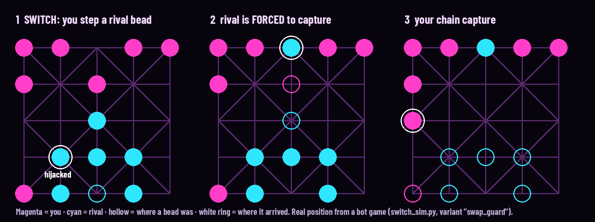

# HIJACK TWELVE — Barah Goti with a Switch

Version 0.1 · 2026-11-03 · **Concept proposal for owner review. Nothing here is approved.**
"HIJACK TWELVE" is a working title; naming and trademarks are not checked.

Inputs:
- the [build-wreck concept](https://github.com/SilverUmer21/build-wreck-concept) ("Build mine. Wreck
  yours. Be ready when we switch."): the concept and its requirements only, not the Magnet Mob game
- the [BarahAI rules engine](https://github.com/SilverUmer21/12_beads_RL_mlops)
- the Afterlight look, [refined in `vesper/`](../vesper/README.md)

The owner's idea, as given:
> 12 beads can be played in a new way: after some time x players also get switches, so you play your
> beads and then switch, and you decide which beads of the enemy to place where, according to rules,
> so it is fun to play and challenging.

*An engine-verified position from a bot game under the recommended rule. During the Switch,
magenta steps the rival's c1 bead to b2, into magenta's line. Barah Goti's mandatory-capture rule
now forces cyan to jump c3×c4, which clears c3. Magenta's a1 bead then chain-captures five beads
(6 v 6 → 6 v 1). Net swing: +4 beads in two turns. Regenerate it with `python find_example.py`.*

## 1. Pitch

**Play your beads. Then play theirs.**

This is Barah Goti, the 5 × 5 village board of Punjab and Sindh, rebuilt as a neon duel. Every
twelve turns the board's veins flare and both players get a **Switch**: for one turn you move one of
your rival's beads. You can't capture with it, but you can walk it into danger. Barah Goti's own
rule does the rest: **captures are mandatory**, so a well-placed rival bead *must* take your bait,
and your chain capture answers.

The build-wreck hook holds exactly. A step is still a step; what changes is **whose future it
shapes**. Ownership never changes (bead colour); control changes for one move (vein colour).

## 2. Why this game (and not a level game)

| The owner's point | How this design answers it |
|---|---|
| "Instead of offline levels failing" | There are no levels to fail. Every match is a duel, so progress means duels won and Switches landed (§6) |
| "Use the player-vs-player switch to mark progress" | The Switch is the scoring highlight of every match. Each Switch gets a public **swing** score (beads won or lost in the next two turns). Ranks, rival unlocks and the replay feed are built on it |
| "Decide which enemy beads go where, according to rules" | The Switch moves one rival bead along a legal line, one step, never a capture. The tested alternative, `place`, lifts a bead to any empty point within 2 (§4) |
| "Fun and challenging" | In the simulation the recommended Switch cuts draws by about 6 points and lifts comebacks from about 32% to 42% of decided games. The stronger bot still wins 85% (§4) |
| "Viral" | The trap → forced capture → chain sequence is a 3-second, sound-on/sound-off readable clip. Share the replay of your best Switch (§7) |

**Novelty, honestly.** Moving an opponent's piece is not new in abstract games:
- [Avalanche chess](https://en.wikipedia.org/wiki/Avalanche_chess) (Ralph Betza, 1977) makes you push one enemy pawn after your own move.
- [Arimaa](https://arimaa.com/arimaa/learn/rulesIntro.html) lets strong pieces push and pull weaker enemy pieces.
- Several [chess variants let you move either side](https://www.chessvariants.com/mvopponent.dir/freeforall.html).

What we found no example of (inference, not exhaustive):
- a **scheduled, reciprocal Switch window** shown as a public countdown
- combined with a **mandatory-capture** board game, so the hijack forces the victim's reply
- on a South Asian folk game with a mobile, short-match presentation

## 3. Rules (prototype ruleset 0.1)

**Base game:** the BarahAI standard ruleset (`barahai.engine.Rules()` defaults):
- 5 × 5 Alquerque board, 12 beads a side, the centre point empty
- step to an adjacent empty point along a line
- jump to capture; chain jumps allowed
- captures are mandatory
- win by capturing every rival bead or leaving the rival without a move
- draw after 40 quiet turns or threefold repetition

**The Switch** (recommended form; §4 shows why):
1. **When.** A public ring of 12 notches around the board fills one notch per turn. At turns 12, 24,
   36 and so on, a **Switch window** opens.
2. **Who opens.** Whoever's turn it is when the ring completes hijacks first; the other player
   answers on the next turn. *(We also tested alternating openers and a trailing-player opener; see §4.)*
3. **What a Switch turn is.** On your Switch turn, **instead of your own move**, you move **one rival
   bead one step** along a line to an empty point. It can't capture, and it can't be passed.
4. **Then the rival plays normally**, under the normal rules. If your hijack gave them a capture,
   they **must** take it.
5. **Anchor.** You can't hijack the bead your rival moved on their last turn. Their newest move
   stays theirs. This rule removed the opener's advantage in testing (§4).
6. **Reciprocal.** The other player's Switch turn follows in the same window. Every window gives
   each player exactly one hijack.
7. **Readability.** The bead keeps its body colour (ownership). During the hijack, your vein
   colour flows along the line into it, and its headlight changes to your colour (control).

Rule 3 is the owner's "decide which bead of the enemy to place where" in its most constrained form.
The `place` variant (move it to any empty point within 2 rows and columns) is the looser form.

## 4. Evidence: what the Switch does to the game

`switch_sim.py` plays the real BarahAI engine with the Switch added. Both sides are a two-turn
alpha-beta search with a capture lookahead at the leaves, 5% random moves and two random opening
turns per side. **Even** = equal bots; **skill** = a strong bot (depth 2) against a weak one (depth 1,
20% random), colours alternating. Seed 12, 300 even and 200 skill games per variant. Turns are full
turns. "Comeback" = the winner was 2 or more beads behind at some point. "Landed" = the hijacker was
better off two turns after the Switch.

| Seed | Variant | Rule | P0 win % | P1 win % | Draw % | Turns | Comeback % | Lead changes | Switches / game | Landed % | Skill: strong wins / draws % |
|---|---|---|---|---|---|---|---|---|---|---|---|
| 12 | `classic` | BarahAI standard, no Switch | 33 | 30 | 37 | 60 | 30 | 1.42 | 0.0 | 0 | 78 / 16 |
| 12 | `swap` | step a rival bead instead of your move; opener = side to move at turn 12n | 52 | 25 | 23 | 50 | 52 | 1.67 | 7.4 | 43 | 76 / 22 |
| 12 | `swap_plus` | step a rival bead and then make your own move | 52 | 35 | 13 | 48 | 30 | 1.50 | 6.8 | 54 | 90 / 2 |
| 12 | `place` | lift a rival bead to any empty point within 2 | 37 | 32 | 30 | 53 | 28 | 1.37 | 7.7 | 43 | 88 / 8 |
| 12 | `earned` | losing beads charges one Switch (max 1), spend any turn | 23 | 37 | 39 | 47 | 47 | 2.53 | 9.7 | 63 | 84 / 15 |
| 12 | `swap_guard` | swap + the bead your rival just moved cannot be hijacked | 35 | 33 | 32 | 58 | 42 | 1.66 | 7.1 | 43 | 85 / 9 |
| 12 | `swap_alt` | swap, openers alternate per window | 31 | 46 | 23 | 48 | 52 | 1.82 | 7.0 | 44 | 74 / 22 |
| 12 | `swap_behind` | swap, the trailing player opens | 25 | 35 | 40 | 51 | 54 | 1.88 | 7.5 | 41 | 62 / 35 |
| 12 | `place_behind` | place, the trailing player opens | 23 | 35 | 43 | 57 | 42 | 1.65 | 8.3 | 40 | 82 / 15 |
| 12 | `swap_guard_alt` | swap_guard, openers alternate | 32 | 47 | 21 | 52 | 44 | 1.63 | 6.3 | 44 | 87 / 8 |
| 99 | `classic` | BarahAI standard, no Switch | 36 | 28 | 36 | 59 | 34 | 1.48 | 0.0 | 0 | 80 / 14 |
| 99 | `swap_guard` | swap + the bead your rival just moved cannot be hijacked | 39 | 31 | 29 | 55 | 42 | 1.71 | 6.8 | 43 | 86 / 10 |
| 99 | `swap_guard_alt` | swap_guard, openers alternate | 39 | 40 | 21 | 52 | 50 | 1.81 | 6.2 | 45 | 84 / 10 |
| 99 | `swap_guard_behind` | swap_guard, the trailing player opens | 26 | 35 | 38 | 59 | 54 | 1.87 | 7.5 | 40 | 84 / 11 |

**How to read it.** With 300 games, a single rate is accurate to about ±3 points, and the gap between
P0 and P1 to about ±5. Classic Barah Goti itself gives the first player about +5 points (33/30 and 36/28).

- **Any Switch makes the game more decisive.** All four fixed-schedule step variants cut draws
  against classic (37% and 36%): `swap` to 23%, `swap_guard` to 32% and 29%, `swap_plus` to 13%.
  Games are 2–12 turns shorter.
- **Plain `swap` creates a first-mover problem.** The player who hijacks first wins 52% to 25%.
  Our reading (inference): the opener's hijack is answered, but the opener moves again before the answer lands.
- **The anchor fixes it.** With `swap_guard`, P0/P1 is 35/33 and 39/31 on the two seeds, the
  same edge as classic. Comebacks rise from 30–34% to 42% on both seeds, lead changes rise, and the
  strong bot still wins 85–86%. **This is the recommended Switch.**
- **Alternating openers is more dramatic but tilts toward P1.** `swap_guard_alt` reaches 21% draws
  and 44–50% comebacks, but P0/P1 is 32/47 on seed 12 and 39/40 on seed 99, an ~8-point P1 edge
  over 600 games. Worth a later balancing pass (for example, a pie rule), not first.
- **Letting the trailing player open backfires.** `swap_behind`, `place_behind` and
  `swap_guard_behind` push draws back up to 38–43%. Catch-up stalls games instead of turning them, and
  skill counts less (the strong bot's win rate falls to 62% in `swap_behind`). Rejected.
- **`swap_plus`** (hijack and also move) is the most decisive (13% draws) and the most skill-heavy
  (90% strong wins, 2% draws). The bigger turn favours the better player and adds no comebacks.
  It's a candidate for an "expert" mode.
- **`place`** (the looser "set it anywhere within 2") is balanced but no more dynamic than classic.
  It also offers far more choices per Switch (any rival bead to any empty point within 2) than one step, which is a lot to scan on a phone.
- **`earned`** (losing beads charges a Switch) has the most lead changes (2.5 per game) but the
  most draws (39%) and a P1 tilt. The back-and-forth rarely resolves.
- About **43% of hijacks "land"** (the hijacker is ahead two turns later). The Switch is a real
  decision, not a free win.

**Limits.** These are bots, not people. Bot strength is low (two-turn lookahead). "Fun" isn't
measured, only its proxies: decisiveness, comebacks, lead changes and skill expression. A
same-device playtest is the real test (§8).

## 5. The look: Afterlight on a board

| Game element | Visual (from the magenta cut) |
|---|---|
| Board | The Alquerque lattice as **molten vein channels** in black glass, on the wet studio floor. Exactly the end shot of the film |
| Your beads / rival beads | Glass domes with a living core: **magenta Vesper** against **cyan Glacier**. Later: micro-cars from the Afterlight family as bead skins |
| Legal moves | A **pulse travels** along each legal line from the selected bead (the vein pulse shader); capture landings glow white-hot |
| Capture | The bead **boost-jumps**: twin mini-plumes, a shock ring on landing, the captured bead bursts into embers |
| Chain capture | Each extra jump raises the board **temperature** (the magma ramp): magenta → hot pink → white |
| Switch countdown | Twelve notches around the board fill like the cabin heart; the heartbeat speeds up in the last 3 turns |
| Hijack | Your colour **floods** along the line into the rival bead (the flood front); its headlight turns your colour for one move, then drains back |
| Win | The winner's veins flood the whole lattice; the loser's beads cool and drain |

All of these are the cheap techniques in [LEARNED-CONCEPTS §4](../docs/afterlight-study/LEARNED-CONCEPTS.md#4-what-carries-over-to-a-phone-game-inference).
The board is a top-down diorama, which suits the folio-style telephoto camera.

## 6. Progress without failing levels

- **Rival ladder (offline, R2/R3).** Labelled AI rivals with names and a *Switch personality*: the
  Trapper (forced-capture baits), the Blocker (hijacks to choke your mobility), the Gambler (place-style
  wild Switches in its own mode). Beat a rival to unlock the next and a bead skin.
- **Switch score.** Every Switch gets a public swing (beads won or lost within two turns). Match
  results show your best Switch. Ranks come from wins plus landed Switches, never from paid power (R1, R11).
- **Daily Switch Puzzle (R7).** A seeded position: "find the hijack that wins 3." The engine solves
  every puzzle before it ships. `find_example.py` is the seed of this generator.
- **Losing still teaches.** The result screen replays the Switch that decided the match, from both sides.

## 7. Why it could spread (inference)

1. **The 3-second clip.** Hijack → forced capture → chain jump reads with sound off, and the plume
   jump and lattice flood make it striking in a feed.
2. **Cultural hook.** Barah Goti / 12 Guti / Bara Tehni is played across Pakistan, India and
   Bangladesh. A known game with one twist is easier to share than a new one.
3. **Two players, one phone (R12).** Pass-and-play needs no network; a hijack makes the person
   across the table react out loud.
4. **A family of games.** "Classics with a Switch": the same rule fits Ludo, Nine Men's Morris and
   Bagh-Chal. Each is a later, separate test.

## 8. Fit with the build-wreck requirements

| Req. | How this concept meets it |
|---|---|
| R1 | No ads or offers in a match |
| R2 | AI rivals are labelled and named |
| R3 | The full game works offline; the engine is pure Python and ports to GDScript or C# |
| R4 | Comebacks come from a visible, scheduled rule (the Switch, +10 points of comebacks in simulation). No hidden rubber-banding. A trailing-player opener was tested and rejected |
| R5 | The countdown ring is public, and every hijack is replayable |
| R6 | Sabotage is reciprocal (one hijack each per window) and bounded (one step, no capture) |
| R7 | Puzzles are engine-solved |
| R8 | Variety comes from rivals and Switch variants, not reskinned levels |
| R9 | The game is turn-based, so pause and resume are trivial |
| R10 | Variants ship as flags (`Rules` already has flags for every rule) |
| R12 | Path: CPU → same device → async online |

## 9. Next steps (for owner decision)

1. **Choose the Switch form:** `swap_guard` (recommended: step instead of your move, with the anchor), or
   the more dramatic `swap_guard_alt` after balancing, or `swap_plus` as an expert mode.
2. **Paper prototype or hotseat test** in the existing pygame client: a `switch` flag in
   `barahai.engine.Rules` and a Switch turn in `GameState`, without touching the standard ruleset.
3. **Godot style lab:** the lattice, beads, pulse and flood shaders from `vesper/` on a phone, at the
   owner's test phone sizes.
4. **A 15-second LinkedIn or TikTok teaser** cut from the film's last beat plus a hijack sequence.

## Files

| File | Purpose |
|---|---|
| `switch_sim.py` | Variants, bots and the experiment; writes `results.json` |
| `results.json` | The numbers in §4, by seed |
| `find_example.py` | Finds and draws a real hijack trap (`hijack_example.png`) |

Run from this folder: `python switch_sim.py` (needs the
[12_beads_RL_mlops](https://github.com/SilverUmer21/12_beads_RL_mlops) checkout next to this
repository, or `BARAHAI_SRC=/path/to/12_beads_RL_mlops/src`).
