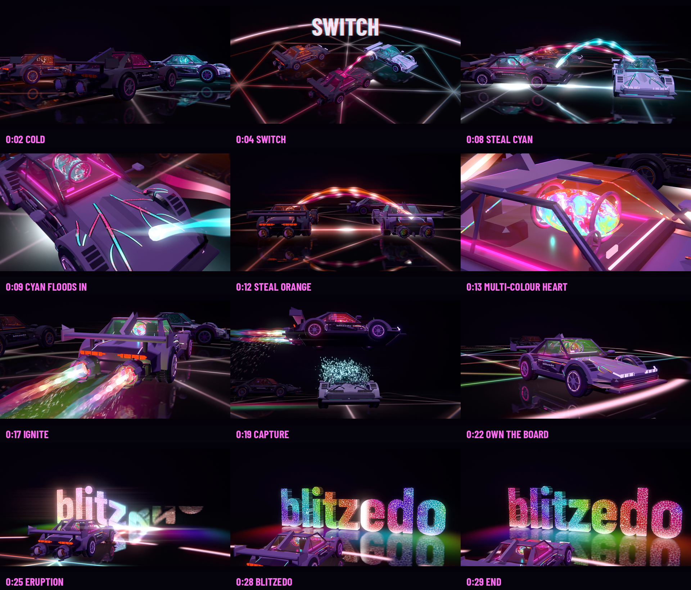

# THE HIJACK — a blitzedo story film

30 seconds · 1920×1080 · 30 fps · stereo · ends on the **blitzedo** reveal.

**[Watch HIJACK_30s.mp4](HIJACK_30s.mp4)**



The magenta cut ([`vesper/`](../vesper/README.md)) showed the effects. This film tells a story, and
that story is the [HIJACK TWELVE](../hijack12/HIJACK-TWELVE.md) game in one move:
**play your beads, then play theirs.**

## The story

| Time | Beat | What you see | What you hear |
|---|---|---|---|
| 0–4 s | **Cold** | Vesper sits dead and grey on the glowing Barah Goti board. Glacier (cyan) and Cinder (orange) idle, alive. The 12-notch Switch ring around the board fills | A dark drone, the rivals' engines humming, a failing heartbeat, a tick per notch |
| 4–6.6 s | **SWITCH** | The ring completes, "SWITCH" slams on screen, Vesper's heart slams, and a magenta hook arcs to Glacier | Reverse swell, braam, sub drop, impact, an electric zap across the stereo field |
| 6.6–10.4 s | **Steal cyan** | Cyan energy arcs out of Glacier and floods Vesper's veins from the nose. Glacier drains to grey | An energy siphon that pans with the arc; Glacier's engine powers down; an arrival hit |
| 10.4–14.5 s | **Steal orange** | The same with Cinder, flooding from the tail. Vesper's heart turns into a multi-colour swirl | A deeper siphon, a pulsing ostinato building, taikos, a bigger arrival braam |
| 14.5–17.5 s | **Ignite** | Lamps, petals, pops in cyan, orange and magenta, then multi-colour plumes with shock diamonds | Petal ticks, pops, a riser, then the ignition braam, sub drop and roar |
| 17.5–21 s | **Capture** | A slow-motion boost-jump over Glacier, which dissolves into cyan embers (a Barah Goti capture) | The world goes underwater: muffled roar, a high pad, slow heartbeats, glass-like shatter |
| 21–24.4 s | **Own the board** | A hard landing with a shock ring; multi-colour light floods every line of the board | The drop: braam, kick and clap, a sidechained bass, colour stabs, a bell arpeggio |
| 24.4–30 s | **blitzedo** | A hard cut to silence. Lava races ahead along the floor, and the 3D **blitzedo** letters erupt left to right in molten multi-colour, then a light sweep | Silence, rumble, an eruption, one plucked bell per letter rising in F Yaman, the final chord, a light-sweep shimmer, one last heartbeat |

## How it's built

`film.py` drives the same unchanged Afterlight cars ([`afterlight/`](../afterlight/README.md)) with
new shaders in `shaders/`:

- **Multi-colour energy.** `common.glsl` defines magenta, cyan and orange, a mixing ring through
  violet, lime and red, and a heat ramp for any hue. Each car carries the energies it holds; in the
  stealing car they flood in from the nose (cyan) and the tail (orange).
- **Steal arcs.** 3D Bézier tubes (`beam.*`) from one car's heart into another car, with a
  travelling head and flowing dashes, plus matching streams along the board lines on the floor.
- **The board.** Alquerque lattice lines tinted by whoever is nearby and alive, the 12-notch Switch
  ring, and the multi-colour flood from the landing point (`floor.frag`).
- **Capture.** A noise dissolve with glowing edges on every material of the captured car, plus 2,600
  embers (`burst.*`).
- **blitzedo.** The wordmark (Barlow Condensed, as on the cars) is voxel-extruded into 3D letters
  (`build_logo`). They rise with an overshoot, left to right, with molten multi-colour fronts,
  obsidian sides and a light sweep (`logo.*`). They also light the car.
- **Post and motion.** Two bloom radii, an anamorphic streak, heat haze, chromatic fringe, grain,
  3–5 motion-blur sub-frames, a camera rig and a slow-motion time curve for the jump.

`score.py` synthesises the whole soundtrack with NumPy and SciPy (no samples):
- braams, sub drops, impacts, reverse swells and risers
- energy siphons, a pulsing ostinato, and hybrid drums with a sidechained bass
- shatter, lava and Karplus-Strong bells
- a convolution hall, a gated cut before the logo, and bus glue

`master.py` masters to −14 LUFS / −1 dBTP for social feeds.

## Reproduce

```bash
cd hijack_film
python3 film.py --stills --width 1920 --height 1080       # 11 story stills -> renders/
python3 film.py --width 2560 --height 1440 --subframes 3  # picture (~60-80 min on 4 CPU threads)
python3 score.py && python3 master.py                     # -> HIJACK_30s.mp4
```

Requirements: those of Afterlight (EGL/OpenGL 3.3, NumPy, Pillow, FFmpeg) plus SciPy for the score.
