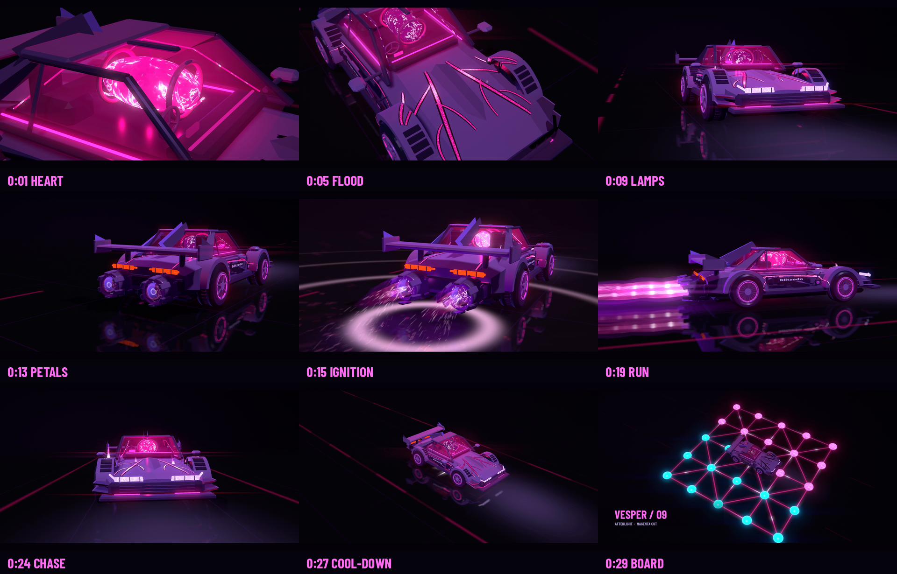

# VESPER / 09 — MAGENTA CUT

A 30-second motion piece built only around the magenta Vesper from
[Afterlight](../afterlight/README.md). It reuses the original car geometry, aero and boosters,
unchanged. The energy story, lava, plumes, floor, post-processing, camera and score are new.

**[Watch VESPER_30s.mp4](VESPER_30s.mp4)** · 1920×1080 · 30 fps · stereo AAC · 30 s



The idea: in the original film the energy simply glows. Here it **travels**. The heart wakes in the
dark and floods the arteries with lava. The energy lights the lamps, then the boosters. Once the run
is over it drains back home, and the car comes to rest on a Barah Goti board, the first look at the
[HIJACK TWELVE](../hijack12/HIJACK-TWELVE.md) game concept.

## Beat sheet

| Time | Shot | What happens |
|---|---|---|
| 0–3.2 s | **Heart** — close on the cabin | Darkness. The plasma heart beats lub-dub, faster each time. The key light is still "asleep", so the heart lights the cabin alone |
| 3.2–8 s | **Flood** — high pass over the hood | Lava floods out from the cabin along all 18 arteries behind a white-hot front. Pulses travel through it and light the paint as they pass |
| 8–12 s | **Lamps** — low front | Pale-violet headlamps flicker on like a fluorescent tube. Light pools on the wet floor |
| 12–17 s | **Ignition** — rear three-quarter | Nozzle petals open. Three sputter pops send shock rings across the floor, then ignition: white flash, camera kick, twin three-shell plumes with shock diamonds, embers |
| 17–22.4 s | **Run** — side tracking | The floor streams past at 38 m/s, the plumes stretch, the anamorphic streak and heat haze build |
| 22.4–26.4 s | **Chase** — low, ahead of the car | The car charges at the lens, with speed rumble on the camera rig |
| 26.4–30 s | **Board** — crane up | The plumes collapse, the veins cool and drain from the tips, hot metal ticks. The Barah Goti lattice lights in a wave from under the car, 24 beads pop up (12 magenta, 12 cyan), one last heartbeat, end card |

## What is new compared with Afterlight

The full research and reasoning are in [LEARNED-CONCEPTS.md](../docs/afterlight-study/LEARNED-CONCEPTS.md).

| | Afterlight (original) | Magenta cut |
|---|---|---|
| Vein light on the paint | 6 fixed junction lights | **Up to 24 moving lights**, one per travelling pulse or flood front |
| Pulse speed | `time × speed`, so it jumps while boost ramps | **Phase integrated on the CPU**, shared by veins, flames and lights |
| Lava colour | 2-colour mix | **Magenta temperature ramp**, crust plates with glowing cracks, fBm churn |
| Energy story | Everything glows from frame 1 | Heartbeat → flood → lamps → boost → cool-down → drain home |
| Plume | 2 shells, moving cells | **3 shells** (white core, magenta sheath, violet haze), **stationary shock diamonds**, sputter pops |
| Sparks | Straight lines | **Embers with gravity** that skip on the wet floor |
| Floor | Static mirror | Wet patches, ripples, streaming panel seams with **analytic motion blur**, lane dashes, light pools, **shock rings**, Barah Goti lattice |
| Post | 1 bloom radius, heat haze | 2 bloom radii, **anamorphic streak**, noise heat haze, chromatic fringe, grain |
| Motion | Eased cameras | **Sub-frame motion blur** (3–5 samples), camera-rig shake from speed and ignition |
| Sound | Score per car | One continuous score driven by the same curves; Yaman-scale plucks for the board |

## Files

| File | Purpose |
|---|---|
| `magenta.py` | Timeline curves, shots, world, renderer and post |
| `veins_plus.py` | Afterlight's arteries, plus each artery's centre line for the pulse lights |
| `shaders/` | `common.glsl` (magma ramp), `object`, `vein`, `plasma`, `glass`, `jet`, `spark`, `blaze`, `floor`, `bead`, `bloom`, `composite` |
| `score.py` | NumPy-synthesised score and sound design (`VESPER_score.wav`) |
| `master.py` | Two-pass loudness (−16 LUFS, −1 dBTP) and mux |
| `renders/` | Stills at the nine story beats |

## Reproduce

Same requirements as Afterlight: Linux with EGL/OpenGL 3.3 (Mesa llvmpipe works), Python 3.10+,
NumPy, Pillow and FFmpeg. On Ubuntu, `apt install libegl1 libegl-mesa0` if `libEGL.so.1` is missing.

```bash
cd vesper
python3 magenta.py --stills --width 1920 --height 1080          # nine beat stills -> renders/
python3 magenta.py --width 2560 --height 1440 --subframes 3     # picture (about 75 min on 4 CPU threads)
python3 score.py
python3 master.py                                               # -> VESPER_30s.mp4
```

For a quick moving test: `python3 magenta.py --width 960 --height 540 --start 14 --seconds 3 --subframes 1`.

## Credits

The car, veins and boosters are from Afterlight (this repository). The look follows our study of
Bruno Simon's [folio-2025](https://github.com/brunosimon/folio-2025) (MIT). Techniques are
reimplemented; no folio code or models are used. Font: Barlow Condensed (SIL OFL).
